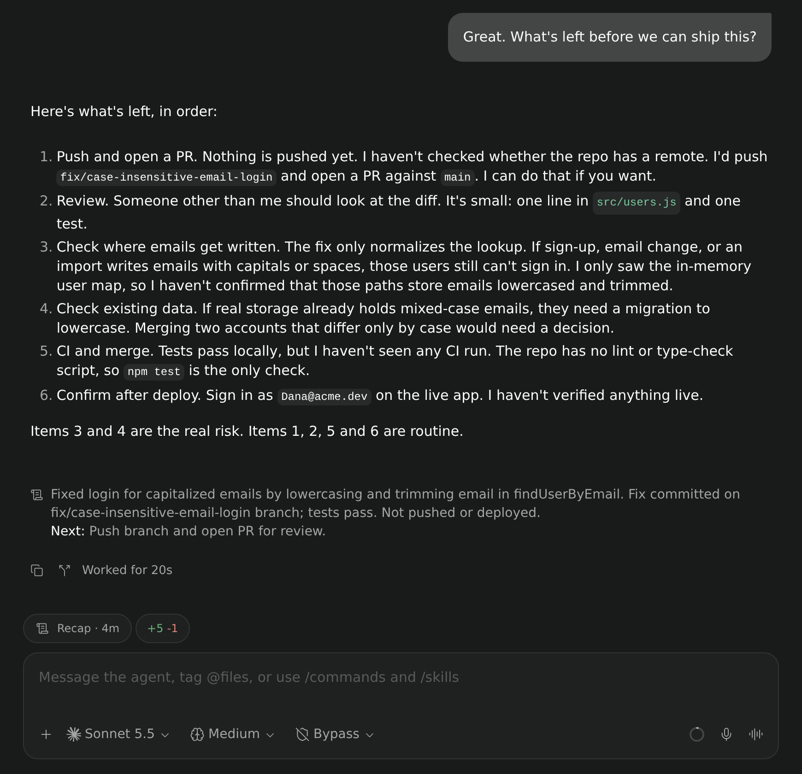

# paseo-recap

**Claude Code-style session recaps for every agent in [Paseo](https://github.com/getpaseo/paseo).**

When an agent finishes a turn, paseo-recap writes a short "where things stand" note — the goal,
what is done, and the next step — and shows it right in the conversation. Glance at any agent and
know where it is, without scrolling back. Works with every provider Paseo runs: Claude, Codex,
OpenCode, OMP, Pi, and custom agents.



## Features

- **Recap in the conversation.** A muted line after the turn it summarizes, with a **Next:** step,
  like Claude Code's session recap. Display-only: it never enters the agent's context.
- **Recap pill on every agent.** Shows the latest recap's age; tap it to read, regenerate, or see
  earlier recaps, or to generate one for an agent that has none yet. `/recap` does the same.
- **Any model.** By default each agent is recapped by its own provider (Claude by Claude Haiku,
  Codex by GPT-6-Luna). Choose Paseo's metadata model or any Claude, Codex, or OpenCode model
  instead; the settings screen shows exactly which models will run.
- **Quiet and cheap.** About 40 words, from recent text only. Skips canceled turns, pending
  permissions, context compaction, and providers near their usage limit. ~3 s and ~$0.002 per recap
  with Claude Haiku.

## Requirements

- Paseo **0.10.3** or later, with plugins enabled (**Settings → Plugins → Enable plugins**, or
  `"pluginsEnabled": true` in `~/.paseo/config.json`)
- At least one of the `claude`, `codex`, or `opencode` CLIs on the daemon's `PATH`, logged in

## Install

```bash
paseo plugin install github:kingsleydon/paseo-recap
```

Recaps start with the next completed turn of each agent. For an agent that is already idle, tap its
**Recap** pill and choose **Generate**.

## Settings

**Settings → Plugins → paseo-recap → Recap.** Numbers and model names are typed in and validated as
you type.

| Setting | Default | Description |
|---|---|---|
| Generate recaps automatically | On | `/recap` and the pill always work, even when off |
| Every N turns | 1 | Completed turns between recaps (1–50) |
| Wait after a turn (seconds) | 10 | Quiet time before a recap; replying sooner skips that turn (0–3600) |
| Start after (messages) | 3 | Your messages before an agent's first recap, as in Claude Code (1–50) |
| Recent exchanges to read | 8 | Your messages and the replies a recap reads, within ~8,000 tokens (1–100) |
| Recap subagents | Off | Also recap agents started by other agents |
| Wait for subagents | Off | Hold an agent's recap while its subagents run, up to 10 minutes |
| Recap model | Same as agent | Same as agent, Metadata model, or Claude / Codex / OpenCode with any model id |

## How it works

1. When a turn completes and the agent stays quiet for the wait time, the daemon-side plugin takes
   the recent user and assistant text — never tool output, file contents, or reasoning — and asks a
   local CLI for a structured `{ summary, next_action }` recap.
2. The recap is stored under `$PASEO_HOME/plugin-data/paseo-recap/` and appended to the
   conversation as a plugin row. A new turn cancels a pending recap and marks the last one out of
   date.
3. CLIs run one-shot in a temporary directory with your existing login and leave no session behind.
   At most two run at once; a CLI that is missing, logged out, or rate limited is skipped for ten
   minutes and the next model is tried.

| CLI | Invocation |
|---|---|
| `claude` | `claude -p --json-schema … --tools "" --strict-mcp-config --setting-sources "" --no-session-persistence`, thinking off |
| `codex` | `codex exec --ephemeral --sandbox read-only --output-schema … --disable hooks`, low reasoning effort, with your Codex configuration |
| `opencode` | `opencode run --pure --agent plan --format json`; the session is deleted afterwards |

See [docs/design.md](docs/design.md) for the full design, edge cases, and a comparison with Claude
Code, Codex, and OMP.

## Privacy and security

- Recaps send recent conversation text to the model you choose, using that CLI's login. Nothing is
  sent anywhere else.
- Claude runs with no tools, MCP servers, or settings. Codex runs in a read-only sandbox with your
  own Codex configuration, including any MCP servers you set up there. OpenCode uses its read-only
  `plan` agent, which rejects permission requests.
- Recaps are stored with owner-only permissions, kept for 30 days, and deleted when the agent is
  archived. Recap rows in the conversation live in daemon memory and are gone after a restart.
- Like every Paseo plugin, this is trusted code that runs unsandboxed on the daemon host.

## Development

```bash
npm install
npm run typecheck
npm test
RECAP_E2E=1 npx vitest run test/generators.real.e2e.test.ts   # real CLIs, costs a few cents
paseo plugin install "$PWD"
paseo plugin reload paseo-recap   # after changes
paseo plugin logs paseo-recap
```

| Path | Contents |
|---|---|
| `index.server.ts` | Daemon entry: lifecycle hooks, RPCs, timeline rows |
| `index.client.tsx` | App entry: recap line, pill, settings screen, `/recap` |
| `server/scheduler.ts` | Per-agent state machine: when to recap |
| `server/history.ts`, `server/prompt.ts` | What a recap reads and the prompt |
| `server/models.ts`, `server/generators.ts`, `server/cli.ts`, `server/process.ts` | Which model runs, queue and fallback, per-CLI arguments, process runner |
| `server/store.ts`, `server/usage.ts` | Recap storage, usage-limit guard |
| `client/` | Recap line, pill and card, settings screen |
| `shared/recap.ts` | Providers, settings schema, recap types, RPC contracts |

## License

[MIT](LICENSE)
